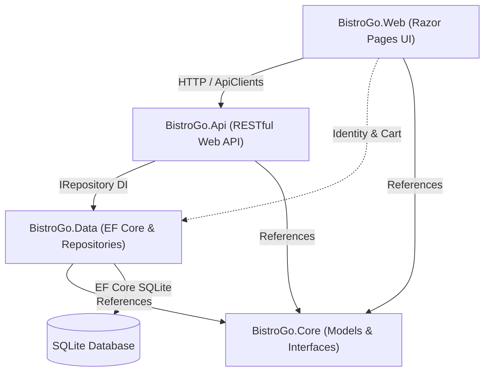

# BistroGo System Architecture & Database Implementation

## 1. Overview

BistroGo is structured around a clean, layered architecture separating core domain logic, data persistence, RESTful API endpoints, and the presentation layer.



---

## 2. Layer Responsibilities

### 2.1 BistroGo.Core
- **Models**: Entity definitions ([`MenuItem`](file:///C:/Users/joshu/source/repos/BistroGo/BistroGo.Core/Models/MenuItem.cs), [`MenuCategory`](file:///C:/Users/joshu/source/repos/BistroGo/BistroGo.Core/Models/MenuCategory.cs), [`Order`](file:///C:/Users/joshu/source/repos/BistroGo/BistroGo.Core/Models/Order.cs), [`OrderItem`](file:///C:/Users/joshu/source/repos/BistroGo/BistroGo.Core/Models/OrderItem.cs), [`PickupTimeSlot`](file:///C:/Users/joshu/source/repos/BistroGo/BistroGo.Core/Models/PickupTimeSlot.cs), [`OrderStatus`](file:///C:/Users/joshu/source/repos/BistroGo/BistroGo.Core/Models/OrderStatus.cs), [`Review`](file:///C:/Users/joshu/source/repos/BistroGo/BistroGo.Core/Models/Review.cs), [`Expense`](file:///C:/Users/joshu/source/repos/BistroGo/BistroGo.Core/Models/Expense.cs)).
- **Interfaces**: Contracts defining persistence operations for each entity:
  - [`IMenuCategoryRepository`](file:///C:/Users/joshu/source/repos/BistroGo/BistroGo.Core/Interfaces/IMenuCategoryRepository.cs)
  - [`IMenuItemRepository`](file:///C:/Users/joshu/source/repos/BistroGo/BistroGo.Core/Interfaces/IMenuItemRepository.cs)
  - [`IOrderRepository`](file:///C:/Users/joshu/source/repos/BistroGo/BistroGo.Core/Interfaces/IOrderRepository.cs)
  - [`IOrderItemRepository`](file:///C:/Users/joshu/source/repos/BistroGo/BistroGo.Core/Interfaces/IOrderItemRepository.cs)
  - [`IPickupTimeSlotRepository`](file:///C:/Users/joshu/source/repos/BistroGo/BistroGo.Core/Interfaces/IPickupTimeSlotRepository.cs)
  - [`IReviewRepository`](file:///C:/Users/joshu/source/repos/BistroGo/BistroGo.Core/Interfaces/IReviewRepository.cs)
  - [`IExpenseRepository`](file:///C:/Users/joshu/source/repos/BistroGo/BistroGo.Core/Interfaces/IExpenseRepository.cs)
  - [`ICartService`](file:///C:/Users/joshu/source/repos/BistroGo/BistroGo.Core/Interfaces/ICartService.cs)

### 2.2 BistroGo.Data
- **DbContext**: [`BistroGoDBContext`](file:///C:/Users/joshu/source/repos/BistroGo/BistroGo.Data/DataAccess/BistroGoDBContext.cs) inherits from `IdentityDbContext<ApplicationUser>` and handles entity mapping, soft-delete global query filters, check constraints, indexes, and reference seeding.
- **Repository Implementations**: Concrete Entity Framework Core implementations for each repository contract:
  - [`EfCategoryRepository`](file:///C:/Users/joshu/source/repos/BistroGo/BistroGo.Data/Repositories/EfCategoryRepository.cs)
  - [`EfMenuItemRepository`](file:///C:/Users/joshu/source/repos/BistroGo/BistroGo.Data/Repositories/EfMenuItemRepository.cs)
  - [`EfOrderRepository`](file:///C:/Users/joshu/source/repos/BistroGo/BistroGo.Data/Repositories/EfOrderRepository.cs)
  - [`EfOrderItemRepository`](file:///C:/Users/joshu/source/repos/BistroGo/BistroGo.Data/Repositories/EfOrderItemRepository.cs)
  - [`EfPickupTimeSlotRepository`](file:///C:/Users/joshu/source/repos/BistroGo/BistroGo.Data/Repositories/EfPickupTimeSlotRepository.cs)
  - [`EfReviewRepository`](file:///C:/Users/joshu/source/repos/BistroGo/BistroGo.Data/Repositories/EfReviewRepository.cs)
  - [`EfExpenseRepository`](file:///C:/Users/joshu/source/repos/BistroGo/BistroGo.Data/Repositories/EfExpenseRepository.cs)
  - [`EfCartService`](file:///C:/Users/joshu/source/repos/BistroGo/BistroGo.Data/Services/EfCartServices.cs)
- **Identity**: Custom user class [`ApplicationUser`](file:///C:/Users/joshu/source/repos/BistroGo/BistroGo.Data/Identity/ApplicationUser.cs) and application roles (`Customer`, `KitchenStaff`, `Manager`).

### 2.3 BistroGo.Api
- Exposes RESTful API controllers with dependency injection of repository interfaces:
  - `CategoriesController` (`/api/categories`)
  - `MenuItemsController` (`/api/menuitems`)
  - `OrdersController` (`/api/orders`)
  - `OrderItemsController` (`/api/orderitems`)
  - `PickupSlotsController` (`/api/pickupslots`)
  - `ReviewsController` (`/api/reviews`)
  - `ExpensesController` (`/api/expenses`)
- Configured with `ReferenceHandler.IgnoreCycles` to handle circular entity navigation properties safely during serialization.

### 2.4 BistroGo.Web
- Razor Pages application providing user interfaces for Customers, Kitchen Staff, and Managers.
- Contains typed HTTP client services in [`BistroGo.Web/Services`](file:///C:/Users/joshu/source/repos/BistroGo/BistroGo.Web/Services) for decoupled communication with the API.
- Manages authentication cookies, user roles, and session carts.

---

## 3. Database Architecture & Design Patterns

### 3.1 Soft-Delete (`IsArchived`) Pattern
To preserve historical records (sales history, past orders, financial audits), entities implement a soft-delete mechanism:
1. Every domain model includes `public bool IsArchived { get; set; } = false;`.
2. In `BistroGoDBContext.OnModelCreating`, each entity is configured with a global query filter:
   ```csharp
   builder.Entity<MenuItem>().Property(i => i.IsArchived).HasDefaultValue(false);
   builder.Entity<MenuItem>().HasQueryFilter(i => !i.IsArchived);
   ```
3. Repository `DeleteAsync(id)` methods set `entity.IsArchived = true; await _db.SaveChangesAsync();` rather than issuing hard `DELETE` statements.
4. Queries throughout the application automatically exclude archived rows without needing explicit `.Where(e => !e.IsArchived)` checks in application code.

### 3.2 Repository Pattern
Data access follows a strict repository-per-entity architecture:
- Controllers and services depend only on abstraction interfaces (`IMenuItemRepository`, `IOrderRepository`, etc.) rather than the concrete EF `DbContext`.
- Repositories encapsulate query logic, eagerly load required navigation properties (`.Include()`), and enforce data consistency rules (e.g., auto-recalculating order subtotals and taxes on line additions or deletions).

### 3.3 Shopping Cart to Placed Order Transition
The `Order` entity serves as both an active shopping cart and a finalized placed order:
- **Shopping Cart**: `IsFinalized = false`, identified by `UserId` (for authenticated users) or a unique `GuestToken` GUID stored in a secure cookie. A filtered unique index (`IX_Orders_UserId_OpenCart`) ensures a user can hold at most one active cart.
- **Placed Order**: `IsFinalized = true`, populated with `FinalizedAt`, `StatusId`, `PickupSlotId`, and `ConfirmationCode`.

---

## 4. API Endpoints Reference

| Controller | Route | Method | Description |
|---|---|---|---|
| **CategoriesController** | `/api/categories` | `GET` | List all active categories |
| | `/api/categories/{id}` | `GET` | Get category by ID |
| | `/api/categories` | `POST` | Create a category |
| | `/api/categories/{id}` | `PUT` | Update a category |
| | `/api/categories/{id}` | `DELETE` | Soft-delete a category |
| **MenuItemsController** | `/api/menuitems` | `GET` | List all menu items |
| | `/api/menuitems/{id}` | `GET` | Get menu item by ID |
| | `/api/menuitems` | `POST` | Create a menu item |
| | `/api/menuitems/{id}` | `PUT` | Update a menu item |
| | `/api/menuitems/{id}` | `DELETE` | Soft-delete a menu item |
| **OrdersController** | `/api/orders` | `GET` | List all orders (supports `?userId=`) |
| | `/api/orders/{id}` | `GET` | Get order details |
| | `/api/orders/by-user/{userId}` | `GET` | Get orders for user |
| | `/api/orders` | `POST` | Create an order |
| | `/api/orders/{id}` | `PUT` | Update order details |
| | `/api/orders/{id}/place` | `POST` | Place/finalize an order |
| | `/api/orders/{id}` | `DELETE` | Soft-delete an order |
| | `/api/orders/{id}/lines` | `GET` | Get line items for order |
| | `/api/orders/{id}/lines` | `POST` | Add line item to order |
| **OrderItemsController** | `/api/orderitems` | `GET` | List line items |
| | `/api/orderitems/{id}` | `GET` | Get line item by ID |
| | `/api/orderitems/by-order/{orderId}` | `GET` | Get lines for an order |
| | `/api/orderitems` | `POST` | Create line item |
| | `/api/orderitems/{id}` | `PUT` | Update line item |
| | `/api/orderitems/{id}` | `DELETE` | Soft-delete line item |
| **PickupSlotsController** | `/api/pickupslots` | `GET` | List slots (supports `?date=`) |
| | `/api/pickupslots/{id}` | `GET` | Get pickup slot by ID |
| | `/api/pickupslots` | `POST` | Create pickup slot |
| | `/api/pickupslots/{id}` | `PUT` | Update pickup slot |
| | `/api/pickupslots/{id}` | `DELETE` | Soft-delete pickup slot |
| **ReviewsController** | `/api/reviews` | `GET` | List customer reviews |
| | `/api/reviews/{id}` | `GET` | Get review by ID |
| | `/api/reviews/by-customer/{customerId}` | `GET` | Get reviews by customer |
| | `/api/reviews` | `POST` | Submit a review |
| | `/api/reviews/{id}` | `PUT` | Update a review |
| | `/api/reviews/{id}` | `DELETE` | Soft-delete a review |
| **ExpensesController** | `/api/expenses` | `GET` | List operating expenses |
| | `/api/expenses/{id}` | `GET` | Get expense by ID |
| | `/api/expenses/by-category/{category}` | `GET` | Get expenses by category |
| | `/api/expenses` | `POST` | Record an expense |
| | `/api/expenses/{id}` | `PUT` | Update an expense |
| | `/api/expenses/{id}` | `DELETE` | Soft-delete an expense |

---

## 5. Typed API Clients (`BistroGo.Web/Services`)

In `BistroGo.Web`, typed `HttpClient` services provide strongly-typed asynchronous access to the API endpoints:
- [`CategoryApiClient`](file:///C:/Users/joshu/source/repos/BistroGo/BistroGo.Web/Services/CategoryApiClient.cs)
- [`MenuItemApiClient`](file:///C:/Users/joshu/source/repos/BistroGo/BistroGo.Web/Services/MenuItemApiClient.cs)
- [`OrderApiClient`](file:///C:/Users/joshu/source/repos/BistroGo/BistroGo.Web/Services/OrderApiClient.cs)
- [`PickupSlotApiClient`](file:///C:/Users/joshu/source/repos/BistroGo/BistroGo.Web/Services/PickupSlotApiClient.cs)
- [`ReviewApiClient`](file:///C:/Users/joshu/source/repos/BistroGo/BistroGo.Web/Services/ReviewApiClient.cs)
- [`ExpenseApiClient`](file:///C:/Users/joshu/source/repos/BistroGo/BistroGo.Web/Services/ExpenseApiClient.cs)

Clients are configured in [`BistroGo.Web/Program.cs`](file:///C:/Users/joshu/source/repos/BistroGo/BistroGo.Web/Program.cs) with base URLs read from `ApiSettings:BaseUrl` in `appsettings.json`.
